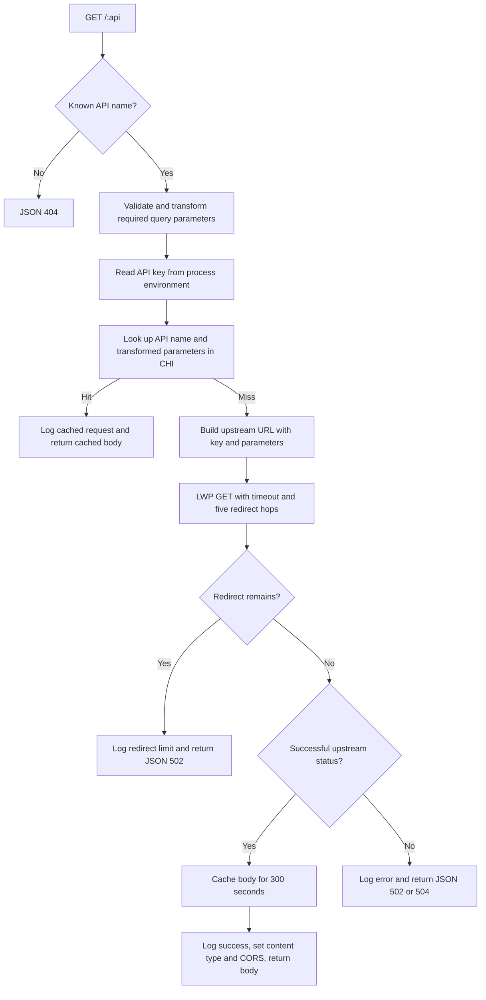

# API proxy architecture

## Application structure

`APIProxy/bin/app.psgi` adds the application's `lib` directory to `@INC`, loads
`APIProxy` and returns `APIProxy->to_app`. Plack or Starman hosts that callable;
there is no database, frontend build or background job system.

`APIProxy/lib/APIProxy.pm` contains the application logic. Its lexical `%apis`
registry is an allowlist of API names and upstream URL templates. Only
`gmap_search` exists. Callers cannot supply an arbitrary initial upstream URL.
The root route renders `views/index.tt` inside `views/layouts/main.tt`; static
assets and error pages live under `public`.

`app_service` supervises Starman through Daemon::Control. The alternative
`public/dispatch.cgi` and `public/dispatch.fcgi` entry points load the same PSGI
application and explicitly select production. They require their own web-server
integration; they are not involved in the documented Plack/Starman launch path.

For Cloud Run, the Docker image runs Starman directly as a non-root user on the
injected `PORT`. `environments/cloud_run.yml` selects console logging and
production error settings. `bin/build_container` publishes to Artifact Registry;
`bin/deploy_container` deploys by digest with a dedicated runtime service account
and a Secret Manager binding for the Google Maps key. GitHub's two deployment
workflows test pull requests and publish/deploy only from `main`. The domain
mapping for `proxy.davecross.co.uk` is a one-time setup described in
[DEPLOY.md](../DEPLOY.md).

## API request flow

This is the implemented flow, including the early cache return and LWP's
bounded redirect handling. Error branches for missing input/key and thrown
exceptions are omitted from the diagram for readability.

## Upstream request construction

The `gmap_search` definition supplies:

| Field | Value and purpose |
| --- | --- |
| `params` | `['q']`, the only forwarded query parameter |
| `url` | `https://www.google.com/maps/embed/v1/search?key=KEY_HERE` |
| `key` | `GOOGLE_MAPS_API_KEY`, the environment variable substituted into the URL |
| `cache` | `1`, enabling CHI lookups and writes |
| `timeout` | `30` seconds, passed to LWP::UserAgent |

The route checks parameter truthiness, replaces characters outside
`\w`, whitespace, hyphen, period and comma with spaces, and converts runs of
literal spaces to `+`. It then appends parameters by string concatenation.
This is destructive normalization rather than correct URL encoding: punctuation
is lost and a whitespace-only query can become `+`.

Each cache miss creates a new LWP::UserAgent. It forwards the incoming `Referer`
if supplied and sets hardcoded browser-like headers, including a Chrome user
agent, English language preference and `Accept-Encoding: gzip, deflate, br`.
There is no persistent application-level HTTP client. Incoming authorization
headers are not forwarded by this code.

LWP follows up to five redirects, including relative `Location` values. If a
redirect remains after that limit, the route returns a JSON 502 response. The
timeout applies to individual LWP requests rather than imposing a total deadline
on route execution.

## Cache and responses

Cache keys are the API name followed by sorted transformed parameter pairs,
for example `gmap_search:q=Clapham+Common`. The environment key and incoming
`Referer` are not part of the key. If upstream output varies with the referrer,
the current key cannot distinguish those responses.

Only successful response bodies are cached, with a TTL of 300 seconds. The code
does not store status or headers. Cache hits return before setting Content-Type
or CORS, and a false or empty cached body is treated as a miss.

The checked-in YAML configures CHI's Memory driver with `global: 0`. The plugin
retains this private cache instance across requests within a worker. It requires
no writable directory or external cache service, and both environments inherit
the setting. Each Starman worker has its own entries; they are not shared across
processes or preserved when a worker restarts. A shared production backend can
be configured through environment YAML if needed; using Memory with `global: 1`
only shares a datastore between cache instances in the same process.

Fresh success responses use the upstream raw body and Content-Type, add wildcard
CORS, and otherwise return the route's normal success status. Upstream status
codes and other metadata are not transparently preserved. In particular,
Content-Encoding is neither forwarded nor decoded, making compressed content
unusable. This service needs explicit response handling rather than assuming
that returning the upstream body is sufficient.

Errors are encoded as JSON by a route-local helper, so successful HTML responses
are not affected by a global serializer. Unknown APIs return 404, invalid
parameters return 400, and a missing server API key returns 500. Failed upstream
HTTP responses and transport exceptions return 502; failures identified as
timeouts return 504. Error responses use `application/json` and wildcard CORS.
The exception callbacks save their failure for the outer route to handle, and
the diagnostic is logged with the configured API key redacted.

## Configuration and logging

`config.yml` selects Template Toolkit with `<% ... %>` delimiters, the main
layout, UTF-8 handling and `behind_proxy: true`.
`environments/development.yml` selects console/core
logging and stack traces. `environments/production.yml` selects warning-level
file logging, disables stack traces and suppresses server tokens.

`log_request` writes JSON directly with `warn`, independently of Dancer's selected
logger. It records a Unix timestamp, API name, transformed parameters, outcome,
duration in seconds and `request->remote_address`. Outcomes include `success`,
`cached`, `error` and `redirect_error`. Successful fresh responses also write a
separate Content-Type diagnostic to stderr. Early validation failures are not
recorded by this helper.

With `app_service`, stderr and stdout go to `PROXY_LOG_DIR/error.log` and
`PROXY_LOG_DIR/output.log`. Dancer's production file logger is a separate output.
Search queries and client addresses therefore appear in logs; configure access
and retention according to the application's deployment needs.

## Extending and operating the application

To add an API, add a `%apis` entry with required parameter names, an upstream URL
containing `KEY_HERE`, an environment-variable name for its key, a cache flag
and a timeout. There is no dynamic registry loader. The current URL builder
assumes the base URL already has a query string, because it appends `&`.

Add isolated route tests for each new API. Different media types, request
headers, upstream statuses and URL formats need deliberate handling; the
current implementation is tailored to one HTML endpoint. If shipping CPAN-style
source distributions, update `APIProxy/MANIFEST` for added application files.

The application implements no authentication or rate limiting. It uses a
server-provided key for every uncached request to a known API. Decide who should
be able to reach the endpoint and enforce the deployment's access policy at
the application or reverse proxy. Wildcard CORS on a fresh successful response
is a browser response policy, not an access-control mechanism.
